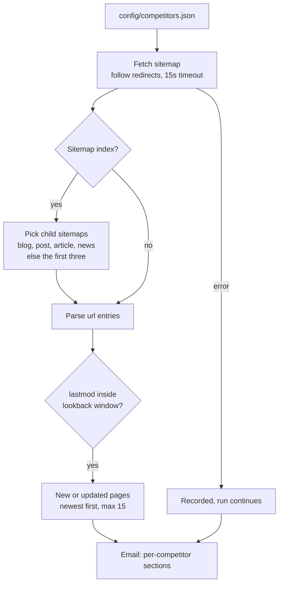

# Competitor Content Monitor: what every competitor published this week, in one email

A small weekly job that reads each competitor's sitemap, picks out the pages published or updated in the last seven days, and emails the list grouped by competitor. No API, no crawler, no paid tool.

## The problem

Knowing what competitors are publishing is useful every week: which topics they are going after, which products they launched, which pages they just rewrote. Checking a dozen sites by hand does not happen consistently, and paid monitoring tools are priced for much more than this.

Every site already publishes the answer. A sitemap lists each URL with the date it last changed, and reading it is one request per site.

## What it does

`src/competitor-content-monitor.js` runs every Monday:

1. Loads the competitor list from `config/competitors.json`.
2. Fetches each sitemap, following redirects.
3. If the file is a sitemap index, follows the child sitemaps for blog, post, article or news content. If none are named that way, it reads the first three.
4. Keeps every URL whose `lastmod` falls inside the lookback window, newest first, capped at 15 per competitor.
5. Emails one report: a count in the subject line, a section per competitor with linked pages and dates, and a note naming any sitemap that could not be read.

## Architecture



## Key design decisions

**Sitemaps instead of crawling.** One or a few small requests per site per week is enough to see everything new. It is cheap, fast and light on the sites being read.

**Content sitemaps are preferred.** Large stores split their sitemap into products, collections, pages and blogs. Following only the content ones keeps the report about what was written, not about every price or inventory change that touched a product page.

**The date filter does the work.** Only entries with a `lastmod` inside the window are reported. An entry with no date, or a date that does not parse, is never treated as new.

**One bad site does not spoil the report.** A timeout, a blocked request or a broken child sitemap is recorded for that competitor and the run moves on. The email names every competitor whose sitemap could not be read, so a silent gap is visible.

**Readable by design.** Results are capped per competitor and sorted newest first, and the subject line carries the total, so the email can be skimmed in a few seconds.

**Polite by default.** Requests are spaced out and carry a client name that identifies the tool.

A known limit: `lastmod` means "changed", not "published". A competitor who edits an old post will show up, which is often worth knowing, but the report does not distinguish the two.

## Repository layout

```
src/competitor-content-monitor.js   fetch, sitemap parsing, window filter, report, email
config/competitors.example.json     example competitor list
scripts/test-sitemap.js             offline tests for parsing and the lookback window
.github/workflows/                  weekly run
```

## Setup

Requires Node 20+ and a mailbox with an app password.

```bash
npm install
npm test                                                     # offline
cp .env.example .env                                         # fill in values
cp config/competitors.example.json config/competitors.json   # your competitors
npm run dry-run                                              # print findings, send nothing
npm run monitor
```

| Variable | Purpose |
|---|---|
| `GMAIL_USER`, `GMAIL_APP_PASSWORD`, `EMAIL_NOTIFY` | Sending the report |
| `LOOKBACK_DAYS` | Window size. Default 7 |
| `CLIENT_ID` | Client name sent with every sitemap request |
| `COMPANY_NAME`, `CONFIG_DIR` | Optional overrides |

Scheduled runs are off by default. Set the repository variable `ENABLE_SCHEDULE` to `true` to turn the schedule on; manual runs from the Actions tab always work.

---

Extracted from a production automation suite I built and ran for a live e-commerce and B2B wholesale business, 2026.

© Michael Wootan. Source shared for portfolio review; all rights reserved.
